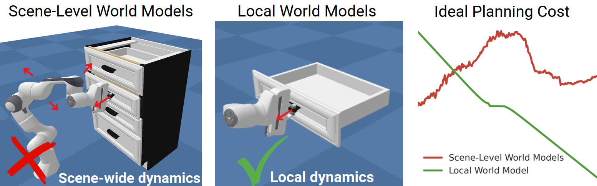

# Local World Models (LWM)

<p align="center">
<a href="https://thijmennijdam.github.io/local-world-models/"></a>
<a href="https://openreview.net/forum?id=T6LLwbiR4S"></a>
<a href="https://huggingface.co/collections/thijmennijdam/local-world-models-6b06b6f6a5501877cced0743"></a>
<a href="https://www.python.org/"></a>
<a href="LICENSE"></a>
</p>
<!-- arXiv badge, add to the row above once the arXiv version is live:
<a href="https://arxiv.org/abs/XXXX.XXXXX"></a> -->

This repository contains training, evaluation and planning code for **Local World Models**, world
models for articulated object manipulation that predict only what matters for the task: the moving
part, one affordance point on it, and the robot state. Combined with sampling-based model predictive
control, a single model opens drawers and doors from closed states on objects it has never seen,
without task-specific policy training.

> <details>
> <summary>⚠️ <b>The planning results differ from the OpenReview version</b> (click to expand)</summary>
>
> After the workshop publication we found and fixed a bug in the planning code. With the fix,
> planning success rates are higher than those reported in the OpenReview version of the paper.
> The arXiv version reports the corrected numbers, and this code
> reproduces them up to run-to-run variation of a few points.
> </details>



## Results

Zero-shot planning success (full opening, SR@0.8, %) on eight seen and eight unseen objects, 50
episodes per object. These are the numbers of the arXiv version.

| Model | No prior | Contact | Contact + kinematics |
|---|:---:|:---:|:---:|
| LWM-100M (seen / unseen) | 9.5 / 15.5 | 34.3 / 37.0 | 40.1 / 60.5 |
| LWM-200M (seen / unseen) | 14.5 / 26.5 | 45.9 / 60.2 | **53.9 / 64.5** |

Trained on interactions with only eight objects, the model plans at least as well on unseen
objects as on seen ones. The [project page](https://thijmennijdam.github.io/local-world-models/)
shows the planner in action.

## Setup

Python 3.9 or newer. Install a CUDA build of PyTorch first if you want to use a GPU.

```bash
git clone https://github.com/thijmennijdam/local-world-models-code.git
cd local-world-models-code
pip install -e .
```

The install is editable because the Hydra configs live in `configs/`.

<details>
<summary>Optional extras</summary>

```bash
pip install -e ".[wandb]"   # Weights & Biases logging during training
pip install -e ".[dev]"     # pytest
```
</details>

## Quick Start

Download the released world models:

```bash
hf download thijmennijdam/lwm-checkpoints --repo-type dataset --local-dir data/lwm-checkpoints
(cd data/lwm-checkpoints && unzip -qn '*.zip')
```

Load one and predict six steps ahead:

```python
import torch
from lwm.world_model.analysis.checkpoint import load_checkpoint

model, ckpt, norm_stats, cfg = load_checkpoint(
    "data/lwm-checkpoints/LWM-200M_d1024_L16/best.ckpt", device="cuda")

observation = {
    "pointcloud": part_points,           # [B, 512, 3]  points on the moving part
    "static_affordance": affordance,     # [B, 3]       the affordance point
    "agent_state": robot_state,          # [B, 10]      position, 6D orientation, gripper opening
    "action_horizon": actions,           # [B, 6, 10]   six actions, normalized with norm_stats["action_mean"/"action_std"]
}
with torch.no_grad():
    out = model(observation)             # predictions are normalized deltas, see norm_stats

out["affordance_delta"]                  # [B, 6, 9]    rigid motion of the part per step
out["agent_state_delta"]                 # [B, 6, 10]   change of the robot state per step
```

`lwm.planning.wm_predictor` wraps this into full rollouts: it normalizes the actions, converts the
predicted deltas back to metric units and moves the part and the affordance point accordingly.

Plan one episode in simulation (needs the PartNet-Mobility objects, see
[docs/REPRODUCE.md](docs/REPRODUCE.md)):

```bash
python scripts/table1_start_states.py      # writes the start states to data/table1-start-states
bash scripts/run_mpc_episode.sh $PWD/data/lwm-checkpoints/LWM-200M_d1024_L16/best.ckpt 45526 \
    $PWD/data/table1-start-states/45526/new_config_45526_2026-02-13-14-06-49_0150 0.4 \
    bias=contact_kinematics execution.seed=14
```

## Reproducing the paper

[docs/REPRODUCE.md](docs/REPRODUCE.md) covers the results step by step: downloading the data,
training both models, the model-scale and data-scale figures, and the planning table.

## Repository layout

| Path | Contents |
|---|---|
| `src/lwm/world_model/` | the model, data loading and training |
| `src/lwm/planning/` | the MPC planner, cost function and planning priors |
| `src/lwm/sim/` | the PyBullet simulation of the articulated objects |
| `configs/` | training recipes, evaluation and planner settings |
| `scripts/` | training, evaluation and the scripts behind the paper's table and figures |
| `tests/` | smoke tests and CPU unit tests |

Data generation and the diffusion policy that collected the interaction data are not part of this
repository.

## Citation

```bibtex
@inproceedings{nijdam2026lwm,
  title     = {Local World Models for Articulated Object Manipulation},
  author    = {Nijdam, Thijmen and Zhobro, Mikel and Gumbsch, Christian and Aljundi, Rahaf and Gavves, Stratis and Zadaianchuk, Andrii},
  booktitle = {RSS 2026 Workshop on Robot World Models},
  year      = {2026}
}
```

## License

MIT, see [LICENSE](LICENSE). Third-party code and assets keep their own licences, listed in
[THIRD_PARTY_NOTICES.md](THIRD_PARTY_NOTICES.md).
